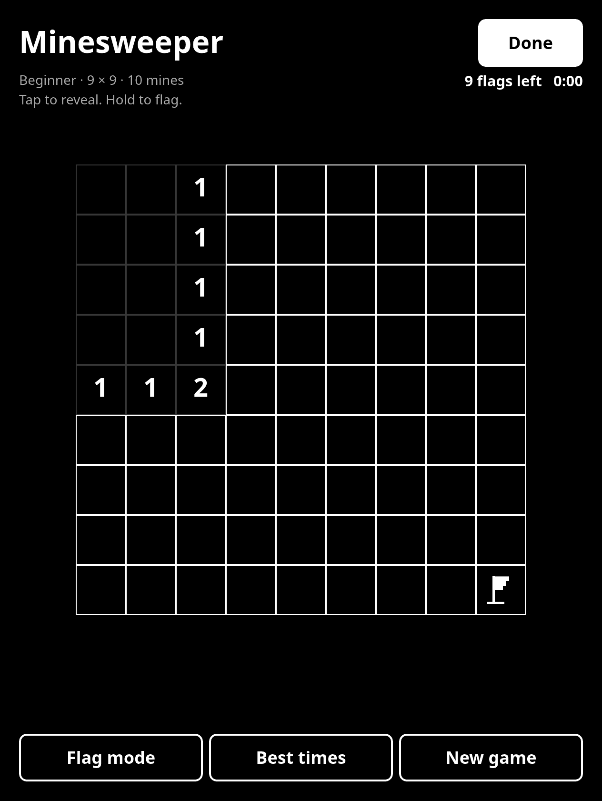

<div align="center">

# Minesweeper

**Minesweeper for jailbroken Kindle e-readers.**

[**Install guide**](INSTALL.md) ·
[**Device notes**](docs/device-notes.md) ·
[**Changelog**](CHANGELOG.md)

</div>

---

Tap to reveal squares and hold to flag suspected mines. The first revealed square and its neighbors are safe.

## Screenshots

<table>
  <tr>
    <td align="center"><br><sub>A beginner game in dark mode</sub></td>
    <td align="center"><br><sub>Choose a board size</sub></td>
    <td align="center"><br><sub>Navigate the expert board</sub></td>
  </tr>
</table>

<sub>Screenshots from the desktop simulator at 1264 × 1680, using sample games.</sub>

## Highlights

- **Three board sizes.** Play Beginner (9 × 9), Intermediate (16 × 16), or Expert (16 × 30).
- **Tap to flag.** Switch on Flag mode to place flags without holding.
- **Scrollable boards.** Swipe or use the arrow buttons to reach the rest of a larger minefield.
- **Saved games and best times.** Resume your board and track the fastest win at each size. The timer pauses when
  the Kindle sleeps.

## Quick start

After setting up PrimitiveOS, open **Store** from Primitive Launcher. Choose **Minesweeper** under **Apps**,
tap **Get**, and open it from the Launcher grid. The [install guide](INSTALL.md) also covers local USB testing.

## Status

Desktop tests and previews passed on macOS, and the ARMHF package passed the local Store fixture.
On an ARMHF Kindle Oasis 3 running firmware 5.18.2, Minesweeper opened from Launcher, showed and closed Best
times with the board unchanged, then returned to Launcher. `app.json` contains the draft Store listing. [Device
notes](docs/device-notes.md)

## Develop locally

Keep the Primitive Tools and Launcher repositories beside this checkout. The desktop command runs sample touch,
timer, and navigation interactions and writes PNG previews to `build/previews`.

```sh
cargo test --offline --locked --workspace
cargo run --offline --locked -p minesweeper-desktop
```

## Licence

Copyright (C) 2026 Doan Nguyen.

- Original code is under the [PolyForm Noncommercial License 1.0.0](LICENSE).
- Original documentation and pictures, including these screenshots, are under [CC BY-NC-SA 4.0](LICENSE-DOCS).
- The Noto Sans fonts supplied by Primitive Launcher retain their SIL Open Font License.
