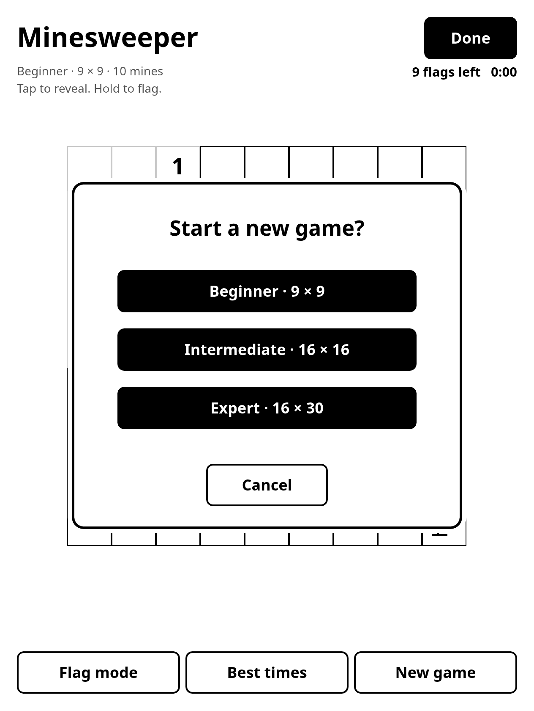
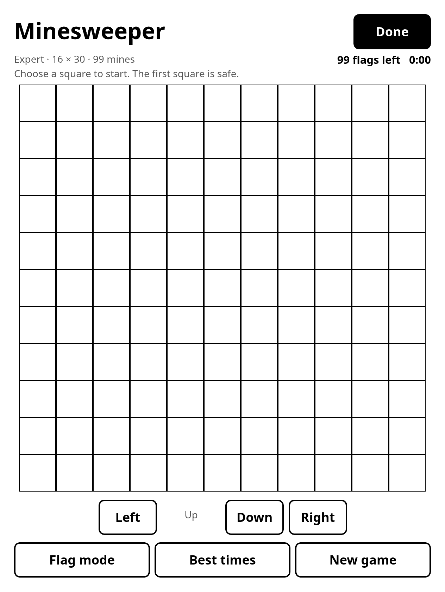

<div align="center">

# Minesweeper

**Clear a minefield on e-ink**

[](https://github.com/PrimitiveOS/kindle-primitive-minesweeper/releases) [](LICENSE) [](https://primitiveos.github.io/kindle-primitive-catalog/v1/index.json)

[**Download**](https://github.com/PrimitiveOS/kindle-primitive-minesweeper/releases/latest) · [**Install guide**](INSTALL.md) · [**Changelog**](CHANGELOG.md)

</div>

---

Play three classic board sizes and track your best times. Tap to reveal and hold a square to flag it. The first square is safe, and larger boards can be explored by swiping.

## Quick start

After setting up PrimitiveOS, open **Store** from Primitive Launcher. Choose **Minesweeper** under **Apps**,
tap **Get**, and open it from the Launcher grid. The [install guide](INSTALL.md) also covers the standalone USB package.

## Screenshots

<table>
  <tr>
    <td align="center"><br><sub>A beginner game in dark mode</sub></td>
    <td align="center"><br><sub>Choose a board size</sub></td>
    <td align="center"><br><sub>Navigate the expert board</sub></td>
  </tr>
</table>

<sub>Screenshots from the desktop simulator at 1264 × 1680, using sample games.</sub>

## Highlights

- **Three board sizes.** Play Beginner (9 × 9), Intermediate (16 × 16), or Expert (16 × 30).
- **Tap to flag.** Switch on Flag mode to place flags without holding.
- **Scrollable boards.** Swipe or use the arrow buttons to reach the rest of a larger minefield.
- **Saved games and best times.** Resume your board and track the fastest win at each size. The timer pauses when
  the Kindle sleeps.

## Develop locally

Keep the Primitive Tools and Launcher repositories beside this checkout. The desktop command runs sample touch,
timer, and navigation interactions and writes PNG previews to `build/previews`.

```sh
cargo test --offline --locked --workspace
cargo run --offline --locked -p minesweeper-desktop
```

## Status

| Device | Status |
|---|---|
| Kindle Oasis 3 (1264 × 1680, firmware 5.18.2) | Tested on hardware |

**Current version: 0.1.1.** Changes are in [CHANGELOG.md](CHANGELOG.md).

## Downloads

The badge at the top shows the number of Store downloads. It counts GitHub downloads of this app's release packages, across all versions and architectures, and is refreshed daily from the [Store catalog](https://primitiveos.github.io/kindle-primitive-catalog/v1/index.json).

## Documentation

[Install guide](INSTALL.md) · [Changelog](CHANGELOG.md) · [Device notes](docs/device-notes.md)

## Licence

Copyright (C) 2026 Doan Nguyen.

- Original code is under the [PolyForm Noncommercial License 1.0.0](LICENSE).
- Original documentation and pictures, including these screenshots, are under [CC BY-NC-SA 4.0](LICENSE-DOCS).
- The Noto Sans fonts supplied by Primitive Launcher retain their SIL Open Font License.
